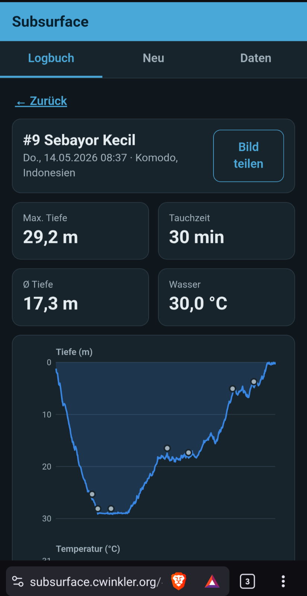
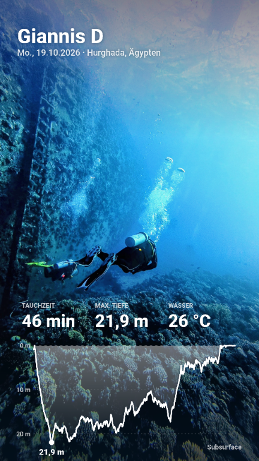
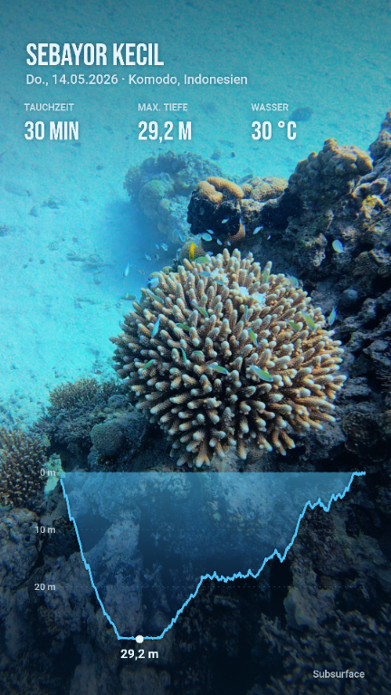

# Topside — a phone-friendly web app for Subsurface dive logs

Import Garmin dives (FIT files) into your [Subsurface](https://subsurface-divelog.org) logbook from
your phone, add buddy, gear and notes, browse your dives with their profiles, and make share images.
Installable as an app, works offline. No PC needed.

**Try it:** [subsurface.cwinkler.org](https://subsurface.cwinkler.org) (the author's own installation;
see [Using a hosted installation](#using-a-hosted-installation)).

<p>
  
  
  
</p>

## Why this exists

On a week-long dive trip I had only my phone with me. My Garmin watch recorded every dive, but
Subsurface Mobile cannot import Garmin FIT files, so the dives stayed stuck in Garmin Connect until I
was back at a PC. Topside closes that gap: export the FIT file from Garmin Connect on the phone,
pick it in Topside, fill in the details, and it lands in the same logbook that Subsurface Desktop
and Subsurface Mobile use.

## Relation to Subsurface

[Subsurface](https://subsurface-divelog.org) ([source](https://github.com/subsurface/subsurface)) is
the open-source dive log program this app is built around. Topside is an **independent project**,
not affiliated with or endorsed by the Subsurface project. It reads and writes Subsurface's git
storage and XML (`.ssrf`) formats; the format code follows Subsurface's own `load-git.cpp`,
`save-git.cpp` and `save-xml.cpp`, and the FIT import follows libdivecomputer's Garmin parser. Thanks
to the Subsurface and libdivecomputer developers for their work. If you only need the desktop or the
official mobile app, use those.

## Features

- **Where the logbook lives:** the Subsurface cloud, an own git repository (GitHub, GitLab, own
  server), or only on the device.
- **Garmin FIT import**, also ZIP exports from Garmin Connect, with duplicate detection.
- **Offline:** the logbook is kept on the device; new dives are stored and uploaded with the next
  sync. Installable on Android and iOS (home screen).
- **Logbook and dive pages** with depth, temperature and heart-rate charts.
- **Share images** with selectable numbers, fonts, colours, text size, portrait or landscape
  formats and your own photo as background (also in the photo's own format); every field can be
  moved on its own.
- **Export and import** Subsurface XML (`.ssrf`), full backups (ZIP) and restore.
- **Trip mode:** copy the logbook into an own git repository before a trip, work with the copy, and
  transfer the new dives into the Subsurface cloud afterwards — the original stays untouched while
  travelling.

**Install on Android:** open the page in Chrome, then menu ⋮ → "Add to home screen" (or "Install
app"). On iPhone: Safari → Share → "Add to Home Screen".

## How it works

- Topside works directly on the Subsurface git storage — the same repository Subsurface Desktop and
  Mobile sync with. There is no separate database and no converter.
- It only writes a logbook it can reproduce byte for byte; otherwise it refuses to write.
- Every change is a normal git commit on top of the current state. Topside never force-pushes, so
  the full history stays available in the repository.
- Browsers cannot talk to the Subsurface cloud directly (no CORS), so a small PHP proxy next to the
  app forwards the git traffic. It runs on ordinary shared hosting.

## Disclaimer

This software is provided **as is, without any warranty**, under the terms of the GPL-2.0 (see
[LICENSE](LICENSE)). Use it **at your own risk**. It writes to your dive log; bugs could damage
it. **Make a backup before first use** (Data → "Full backup", or keep a copy from Subsurface
Desktop), and keep backups before trips. Not intended for dive planning or any safety-relevant use.

## Using a hosted installation

When you sign in, your Subsurface (or git) password is sent to the proxy (`git-proxy.php`) of the
installation you use, which passes it on to the git server. The proxy stores nothing, and the app
does not store passwords either (the browser's password manager can). Still: **only use an
installation whose operator you trust**, or host your own. The offline copy of your logbook is kept
unencrypted in your browser on your device; "Sign out" deletes it.

## Hosting it yourself

You need web space with HTTPS and PHP 8 with cURL; ordinary shared hosting is enough (no Node on the
server).

```bash
npm install
npm run build
```

Upload the contents of `apps/web/dist/` (including `.htaccess` and `git-proxy.php`) to a folder on
your web space.

- **Own git server** (e.g. GitHub) besides the Subsurface cloud: copy `git-proxy.config.example.php`
  to `git-proxy.config.php` and list the host names. The proxy reaches no other servers. Every listed
  host is reachable through your proxy for anyone who can open your installation, so consider
  protecting the folder with a password.
- **Own app name:** `VITE_APP_NAME=...` in `apps/web/.env.local` before building.
- **Legal notice / privacy page:** copy `legal.example.html` to `legal.html`, fill it in; the app
  links it in the footer when present. Check what your country requires — the template is not legal
  advice.

## Development

Requires Node.js 22.12 or newer.

```bash
npm install
npm test            # unit tests, including sync against a local git server
npm run typecheck
npm run dev         # app on http://localhost:5173 with a built-in git proxy
```

Live Server and similar static servers cannot run `git-proxy.php`; use `npm run dev` locally.
More in [CLAUDE.md](CLAUDE.md) and [docs/format.md](docs/format.md).

## License

GPL-2.0-only, the same license as Subsurface. See [LICENSE](LICENSE). Bundled fonts (Bebas Neue,
Anton, Archivo Black, Righteous, Kanit, Bangers, Comic Neue, Pacifico) are under the SIL Open Font
License 1.1.
